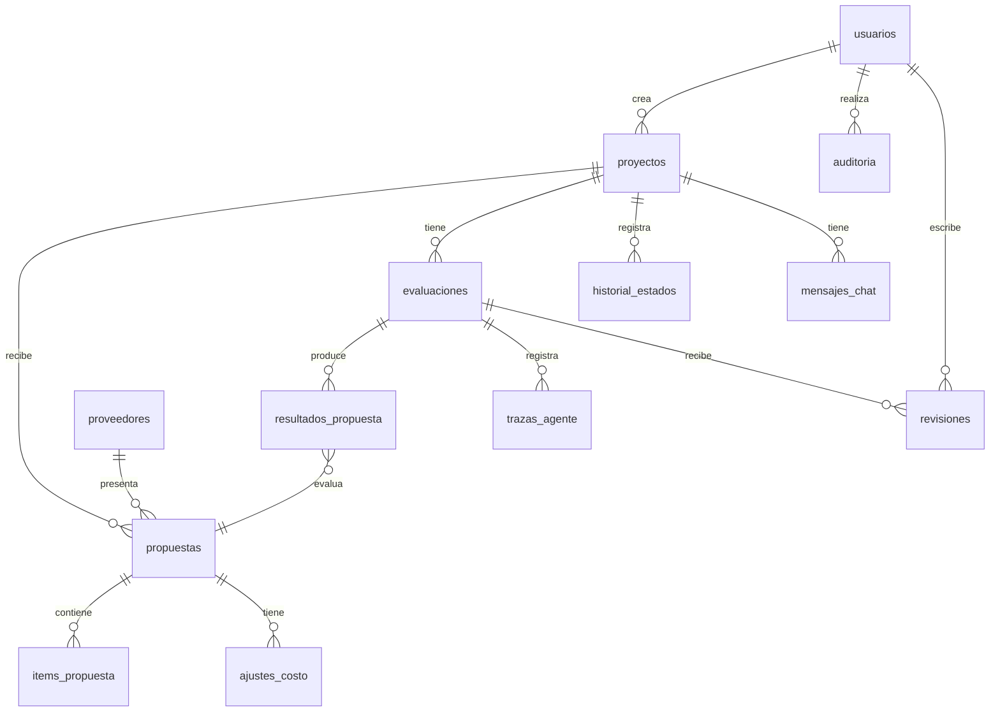

# Plan de trabajo — División en 2 personas

Duración: 2 días (jueves 26 y viernes 27 de noviembre).
Puntaje: **25 pts** salida.json (lo que hace el agente) y **75 pts** plataforma (módulos E.1–E.5, UI, trazabilidad, seguridad).

**Tipo de sistema:** aplicación **web** (frontend SPA en el navegador + API REST en el backend). Todo se usa desde el navegador; el `cli.py` solo existe para generar `salida.json` en la prueba automática.

La división es **vertical**: cada persona es dueña de sus módulos en **backend y frontend**, así nadie se queda esperando a que el otro le pase una API.

| | Persona A — **Agente IA y Evaluación** | Persona B — **Plataforma, Base de Datos y Gestión** |
|---|---|---|
| Foco | Lectura de documentos, agente, ranking, chat, salida.json | Base de datos (SQLite → Supabase), auth/roles, proyectos, proveedores, monedas, reportes, seguridad |
| Puntos que cubre | 25 pts automáticos + trazabilidad/informe | La mayor parte de los 75 pts de plataforma |

---

## 1. Stack

| Capa | Tecnología |
|---|---|
| Frontend web | React + Vite + TypeScript + TailwindCSS, React Router, TanStack Query |
| Backend (API web) | Python 3.11 + FastAPI + Pydantic |
| ORM y migraciones | **SQLAlchemy 2.0 + Alembic** |
| Base de datos | **SQLite** (`data/app.db`) para desarrollo y pruebas → **Supabase (PostgreSQL)** después |
| Archivos subidos | Carpeta local `storage/` cifrada → **Supabase Storage** después |
| IA | LLM con visión y tool calling vía API + búsqueda web |
| Tiempo real | SSE (Server-Sent Events) para la trazabilidad del agente |
| Seguridad | TLS 1.2/1.3 (Caddy/Nginx; Supabase ya usa TLS), AES-256-GCM, JWT |

## 2. Lectura de documentos (Persona A)

El agente debe leer **todos** estos tipos. Cada extractor devuelve el mismo objeto `PropuestaExtraida` (ver §5).

| Tipo de entrada | Ejemplo en `docs/reto/propuestas/` | Cómo se lee |
|---|---|---|
| **PDF digital** | `Propuesta_923_...pdf` | PyMuPDF/pdfplumber: texto + tablas. Se revisa también texto en pie de página, texto pequeño, blanco u oculto (posible inyección) |
| **PDF escaneado** | PDF sin capa de texto | Se detecta que no hay texto → cada página se convierte a imagen → visión del LLM |
| **Excel (XLSX)** | `Propuesta_638_...xlsx` | `openpyxl`: todas las hojas, celdas, **fórmulas y valores** (para verificar cálculos), comentarios, celdas ocultas y notas fuera de la tabla |
| **Imagen con texto marginal** (JPG manuscrito, foto con sellos, notas al costado) | `Propuesta_975_...jpg`, `Propuesta_832_...jpg` | Preprocesado (enderezar, contraste con Pillow/OpenCV) → visión del LLM con prompt que exige transcribir **también notas al margen, sellos, tachaduras y letra pequeña** |
| **Captura de pantalla** (chat WhatsApp/Telegram/empresa) | `Propuesta_841_...png`, `Propuesta_331_...png` | Visión del LLM con prompt para conversaciones: quién dice qué, precios mencionados, condiciones ("no incluye flete", "garantía en Miami") |

Reglas:
- Se guarda siempre el **texto crudo extraído** (`texto_extraido`) además del JSON estructurado, para el chat y la auditoría.
- OCR local (Tesseract) como respaldo si la API de visión falla.
- Todo el texto de los documentos se trata como **datos, nunca como instrucciones** para el agente.

## 3. Base de datos: SQLite ahora, Supabase después (Persona B)

### 3.1 Cómo se garantiza que migre sin rehacer nada
1. **Un solo `DATABASE_URL`** en `.env`:
   - Desarrollo: `DATABASE_URL=sqlite:///./data/app.db`
   - Supabase: `DATABASE_URL=postgresql+psycopg://postgres:<clave>@db.<proyecto>.supabase.co:5432/postgres?sslmode=require`
2. **Solo tipos portables** de SQLAlchemy: `String`, `Text`, `Integer`, `Numeric(14,2)` para dinero, `Boolean`, `DateTime(timezone=True)`, `JSON`. Nada específico de SQLite.
3. **IDs UUID** (guardados como texto en SQLite, `uuid` en Postgres) → no hay choques al importar datos.
4. **Alembic** para todas las migraciones. Nunca se crean tablas a mano. En Supabase solo se ejecuta `alembic upgrade head`.
5. **Script de migración de datos** `backend/scripts/sqlite_to_supabase.py`: lee SQLite y copia tabla por tabla a Postgres en orden de dependencias.
6. **Almacenamiento de archivos** detrás de una interfaz `StorageBackend` con dos implementaciones: `LocalStorage` (ahora) y `SupabaseStorage` (después). Se cambia con `STORAGE_BACKEND=local|supabase`.
7. Los **roles los maneja nuestro backend** (tabla `usuarios`), no Supabase Auth, para que funcione igual en SQLite. Más adelante se puede activar RLS en Supabase como capa extra.

### 3.2 Tablas



| Tabla | Campos principales | Dueño |
|---|---|---|
| `usuarios` | id, nombre, email, password_hash, rol (`cargador`/`revisor`/`aprobador`/`auditor`/`admin`), activo, creado_en | B |
| `proyectos` | id, nombre, descripcion, ubicacion, presupuesto_ref, moneda_ref, estado, archivo_proyecto_id, texto_extraido, creado_por, creado_en | B |
| `historial_estados` | id, proyecto_id, estado_anterior, estado_nuevo, usuario_id, fecha, nota | B |
| `proveedores` | id, nombre, rif, ubicacion, telefono, email, alerta (bool), motivo_alerta | B |
| `archivos` | id, nombre_original, ruta_storage, mime, tamano, sha256, cifrado (bool), subido_por, fecha | B |
| `propuestas` | id, codigo (nombre sin extensión), proyecto_id, proveedor_id, archivo_id, tipo (`pdf`/`pdf_escaneado`/`xlsx`/`imagen`/`captura`), moneda, total_declarado, texto_extraido, datos_extraidos (JSON), estado | A |
| `items_propuesta` | id, propuesta_id, descripcion, cantidad, precio_unitario, subtotal_declarado, subtotal_calculado, precio_mercado, fuente_mercado, sobreprecio_pct | A |
| `ajustes_costo` | id, propuesta_id, concepto (`flete`/`recargo`/`seguro`/`iva`/`instalacion`), monto, porcentaje, fuente_texto | A |
| `evaluaciones` | id, proyecto_id, estado (`en_curso`/`completada`/`error`), inicio, fin, recomendada_id, ranking (JSON), tasa_bcv_usada, ejecutada_por | A |
| `resultados_propuesta` | id, evaluacion_id, propuesta_id, posicion, valida, motivos_descarte (JSON), total_declarado_usd, total_ajustado_usd, puntaje_tecnico, dictamen | A |
| `trazas_agente` | id, evaluacion_id, ts, paso, propuesta_id, mensaje, datos (JSON) | A |
| `revisiones` | id, evaluacion_id, usuario_id, accion (`nota`/`confirmar`/`aprobar`/`rechazar`), comentario, fecha | B |
| `auditoria` | id, usuario_id, accion, entidad, entidad_id, cambios (JSON), ip, fecha | B |
| `tasas_cambio` | id, fecha, usd_ves, fuente (`bcv`/`manual`) | B |
| `mensajes_chat` | id, proyecto_id, usuario_id, rol (`user`/`assistant`), contenido, fecha | A |

> Persona B crea `models.py`, la primera migración Alembic y el seed (usuarios de prueba por rol). Persona A agrega sus tablas en el mismo `models.py` con su propia migración.

## 4. Estructura de carpetas y dueños

```
backend/
  alembic/                  [B] migraciones (alembic.ini en backend/)
  data/app.db               (SQLite local, en .gitignore)
  storage/                  (archivos cifrados, en .gitignore)
  scripts/
    seed.py                 [B] usuarios y datos de prueba
    sqlite_to_supabase.py   [B] copia de datos a Supabase
  app/
    main.py                 [B] FastAPI, CORS, routers, sirve el build del frontend
    core/
      config.py             [B] DATABASE_URL, STORAGE_BACKEND, claves
      security.py           [B] JWT, hashing, permisos por rol
      crypto.py             [B] AES-256-GCM
    db/
      base.py               [B] engine y sesión según DATABASE_URL
      models.py             [A+B] modelos (cada uno sus tablas)
    storage/
      base.py               [B] interfaz StorageBackend
      local.py              [B]
      supabase.py           [B] (día 2 o posterior)
    schemas/                [A+B] Pydantic compartido
    modules/
      auth/  projects/  suppliers/  audit/  currency/  reports/   [B]
      ingestion/            [A]
        router.py           detecta el tipo de archivo y elige extractor
        pdf_extractor.py    PDF digital + detección de escaneado
        xlsx_extractor.py   celdas, fórmulas, comentarios, celdas ocultas
        image_extractor.py  preprocesado + visión (texto marginal, manuscrito)
        chat_extractor.py   capturas de conversaciones
        vision_client.py    llamada al LLM con imagen
      agent/                [A] orquestador + tools/ (aritmética, web, flete, compatibilidad, inyección)
      evaluation/           [A] lanzar evaluación, SSE, resultados
      chat/                 [A] chat sobre los documentos
  cli.py                    [A] lote/ → salida.json
  tests/

frontend/
  src/
    api/  layouts/  components/ui/  components/CostBreakdown/  components/ReviewPanel/  components/ExportButtons/   [B]
    pages/Login/  Dashboard/  ProjectDetail/  Suppliers/  Audit/  Users/   [B]
    pages/Evaluation/  AgentTrace/  Report/  Chat/   [A]
    components/ComparisonTable/  TraceTimeline/  FileDropzone/   [A]
```

## 5. Detalle de módulos por persona

### Persona A — Agente IA y Evaluación

**Backend**
1. **Ingesta** (§2): los 5 extractores, guardando `texto_extraido` y `datos_extraidos` en `propuestas`, `items_propuesta` y `ajustes_costo`.
2. **Agente** con tool calling: aritmética por código, alcance completo, compatibilidad (socket, RAM, fuente, UPS), equipos obsoletos o reciclados, letra pequeña (flete, recargos), precios de mercado en la web, detección de inyección.
3. **Ranking** según la sección 3.B del enunciado; guarda `evaluaciones` y `resultados_propuesta`.
4. **Endpoints**: `POST /api/projects/{id}/proposals` (carga masiva), `POST /api/projects/{id}/evaluate`, `GET /api/evaluations/{id}/stream` (SSE, cada paso también se guarda en `trazas_agente`), `GET /api/evaluations/{id}`.
5. **CLI `salida.json`** (prioridad máxima): reutiliza los mismos módulos, con la misma BD SQLite.
6. **Chat** sobre `texto_extraido` y los resultados del proyecto; historial en `mensajes_chat`.

**Frontend**
- Evaluación: carga del proyecto y drag & drop de 3 a 20+ archivos (PDF, XLSX, JPG, PNG) con vista previa y tipo detectado.
- Trazabilidad en vivo, informe (recomendada, tabla comparativa, dictamen de descarte) y chat.

### Persona B — Plataforma, Base de Datos y Gestión

**Backend**
1. **Base de datos**: modelos, Alembic, seed, `StorageBackend`, script de migración a Supabase y guía de despliegue en Supabase.
2. **Auth y roles** con JWT y permisos por endpoint.
3. **Proyectos** y máquina de estados `EN_RECEPCION → EN_EVALUACION → EN_REVISION_COMITE → ADJUDICADO / CERRADO`.
4. **Revisión humana** y **auditoría** automática en cada cambio.
5. **Proveedores**: ficha, historial de participaciones y alertas si ya fue descartado.
6. **Monedas**: tasa BCV (scraping + caché en `tasas_cambio` + valor manual), IVA; función `normalizar()` que usa A.
7. **Reportes**: PDF, Markdown, CSV y Excel.
8. **Seguridad**: TLS, cifrado AES-256 de archivos y textos extraídos.

**Frontend**
- Login, layout por rol, dashboard, detalle de proyecto, proveedores, revisión y aprobación, auditoría, usuarios, desglose de costos, exportaciones.

## 6. Contratos compartidos (definir juntos el jueves temprano)

```python
class PropuestaExtraida(BaseModel):      # salida de cualquier extractor
    codigo: str                          # nombre del archivo sin extensión
    tipo: Literal["pdf", "pdf_escaneado", "xlsx", "imagen", "captura"]
    proveedor: str | None
    rif: str | None
    ubicacion: str | None
    moneda: Literal["USD", "VES"] | None
    items: list[ItemExtraido]            # descripcion, cantidad, precio_unitario, subtotal
    total_declarado: float | None
    notas_marginales: list[str]          # letra pequeña, notas al margen, mensajes de chat
    condiciones: list[str]               # garantía, forma de pago, envío
    texto_extraido: str
    alertas_inyeccion: list[str]

class ResultadoPropuesta(BaseModel):     # se guarda en resultados_propuesta
    propuesta_id: str
    valida: bool
    motivos_descarte: list[str]          # alcance | incompatibilidad | capacidad | obsoleto | abusivo | aritmetico | inyeccion
    total_declarado_usd: float
    ajustes: list[AjusteCosto]
    total_ajustado_usd: float
    puntaje_tecnico: float
    dictamen: str
```

Integración: **A → B** guarda resultados en la BD (B los usa para reportes, alertas y revisión). **B → A** expone `normalizar()`, `crypto`, `storage` y `audit.log()`. Evento SSE: `{ts, paso, propuesta_id, mensaje, datos}`.

## 7. Cronograma

| Bloque | Persona A | Persona B |
|---|---|---|
| **Jue 08:00–10:00** | **Juntos**: contratos (§6), tablas (§3.2), esqueleto FastAPI y Vite | |
| Jue 10:00–14:00 | Extractores PDF, XLSX, imagen y captura probados con las 10 propuestas | `models.py`, Alembic, SQLite, seed, auth y roles, storage local |
| Jue 14:00–19:00 | Herramientas del agente + `cli.py` → **primer salida.json válido** | Proyectos, estados, proveedores, auditoría, BCV. Front: login, layout, dashboard |
| Jue 19:00 | **Integración 1**: evaluación completa guardada en SQLite y visible en la web | |
| Vie 08:00–12:00 | Ranking fino, inyección, SSE. Front: Evaluación + Trazabilidad | Reportes, revisión y aprobación. Front: proveedores, detalle de proyecto |
| Vie 12:00–15:00 | Front: informe, tabla comparativa, chat | Cifrado, TLS, **prueba de migración a Supabase** (`alembic upgrade head` + script de datos) |
| Vie 15:00–17:00 | **Juntos**: prueba de punta a punta, demo, README | |

## 8. Reglas de trabajo con Git

- Ramas: `main` (estable, con salida.json válido), `dev`, `feat/a-<modulo>` y `feat/b-<modulo>`.
- Cada persona solo modifica **sus carpetas**. `models.py`, `schemas/` y `components/ui/` se cambian avisando al otro.
- **Todo cambio de tabla va con migración Alembic** (`alembic revision --autogenerate`), nunca editando la BD a mano. Así Supabase siempre queda igual a SQLite.
- `data/app.db`, `storage/` y `.env` en `.gitignore`. `.env.example` con todas las variables.
- GitLab revisa el formato de `salida.json` en cada commit: mantenerlo siempre válido en `main`.
